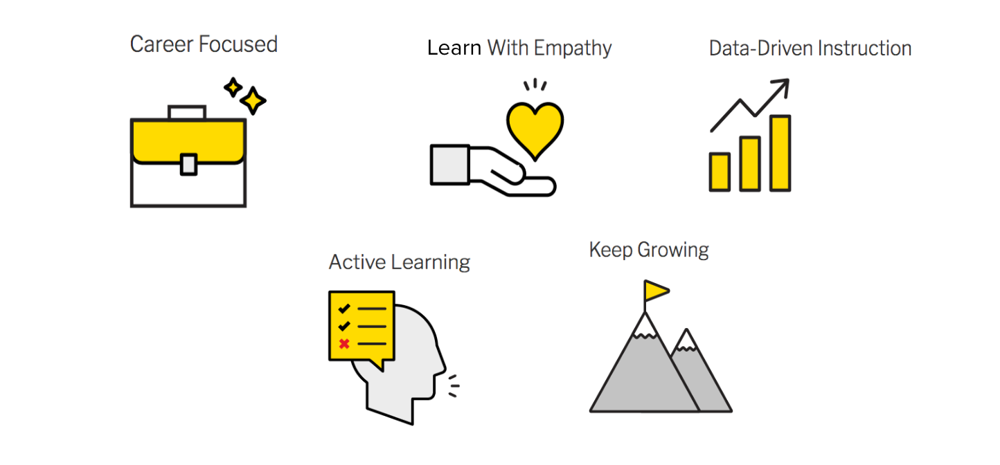
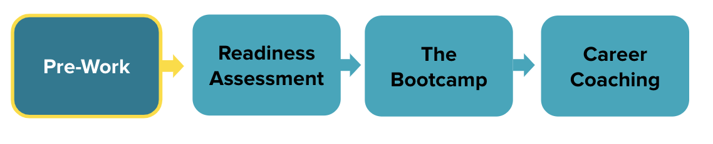
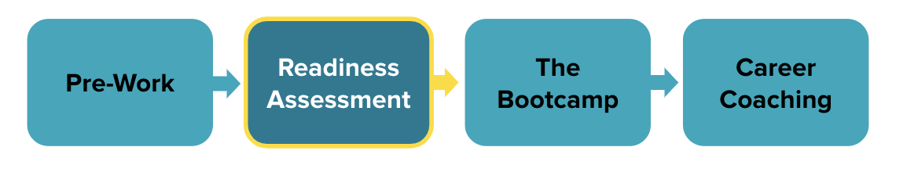
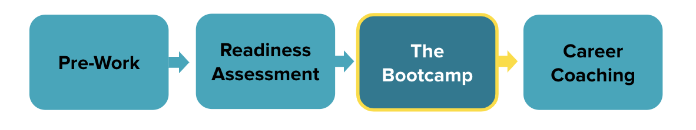
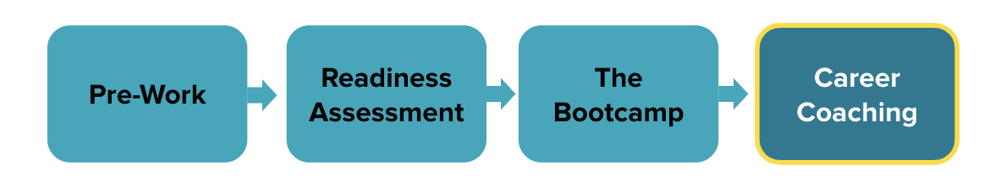
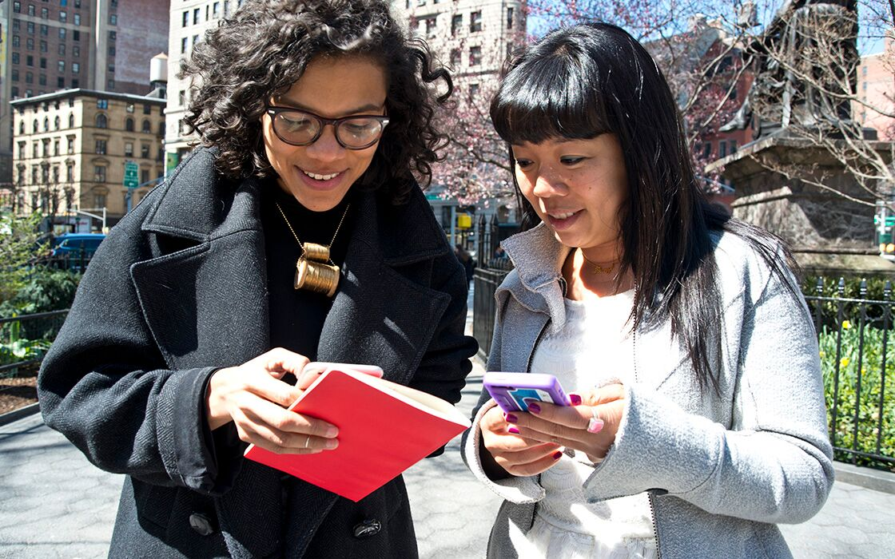

<textarea id="source">

<h1 class="slide-header">Welcome to the Software Engineering Bootcamp</h1>

20 mins

If you’re reading this, you’re on your way to becoming a software engineer. Congratulations!

General Assembly has prepared a pre-course learning experience to help you hit the ground running because, once you get into the classroom, things will move quickly. Let’s see what you have in store!

<h5 id="topics-header" class="color-grey-500">Topics</h5>

Course Flow

Pre-Work Details

---

<h1 class="slide-header">Welcome to the Program</h1>

  

    

      
 

      

        

          

            <video id="wistia_simple_video_135" crossorigin="anonymous"
              poster="https://fast.wistia.com/assets/images/blank.gif" aria-label="Video" controlslist="nodownload"
              playsinline="" preload="auto" type="video/m3u8" x-webkit-airplay="allow"
              style="background: transparent; display: block; height: 100%; max-height: none; max-width: none; position: static; visibility: visible; width: 100%; object-fit: contain;"></video>
          

          

            

              

                

                
<button
                    aria-label="Play Video: A Brief History of the Web" class="w-css-reset w-vulcan-v2-button"
                    tabindex="0" style="width: 0px; height: 0px; pointer-events: none;"></button>

              

              

              

                

                  

                

                

                  

                    

                      

                        <button class="w-big-play-button w-css-reset-button-important w-vulcan-v2-button" tabindex="0"
                          type="button" style="cursor: pointer; height: 78.75px; box-shadow: none; width: 123.047px;">
                          

                          

                          

                          
<svg x="0px" y="0px" viewBox="0 0 125 80" enable-background="new 0 0 125 80"
                            aria-hidden="true" alt=""
                            style="fill: rgb(255, 255, 255); height: 78.75px; left: 0px; stroke-width: 0px; top: 0px; width: 100%; position: absolute;">
                            <rect fill-rule="evenodd" clip-rule="evenodd" fill="none" width="125" height="80"></rect>
                            <polygon fill-rule="evenodd" clip-rule="evenodd" fill="#FFFFFF" points="53,22 53,58 79,40">
                            </polygon>
                          </svg>
                        </button>
                      

                    

                    

  

    <button aria-label="Click for sound" class="w-vulcan-v2-button click-for-sound-btn"
      style="background: rgba(0, 0, 0, 0.8); border: 2px solid transparent; border-radius: 60px; cursor: pointer; display: flex; justify-content: space-between; align-items: center; outline: none; pointer-events: auto; position: absolute; right: 20.1484px; top: 20.1484px; max-width: 589.703px;">
      

        Click
          for sound
      
<svg viewBox="0 0 237 237" width="51.6796875" height="51.6796875"></svg>
    </button>

                

              

            

          

        

      

    

  

---

<h1 class="slide-header">Educational Values</h1>

First things first: Our educational values. These are General Assembly's guiding principles to how we approach education, and ultimately to how instructors support our student’s learning experiences.

At General Assembly, we share the following educational values.

---

<h1 class="slide-header">GA's Educational Values</h1>

**Career-Focused**

GA students join to **advance their careers**. Set high expectations for yourself and your peers, just as you would in a professional setting. Be **proactive, professional, and take pride in your work**.

**Learn with Empathy**

GA values **diversity and inclusivity**. Students and staff come from different backgrounds—approach learning with **empathy, openness, and respect** for different perspectives.

**Data-Driven Instruction**

We support student growth by using **data-driven insights** to enhance learning. Feedback, assessments, and student progress help us tailor instruction effectively.

**Active Learning**

You are in charge of your learning journey! Instructors and staff **facilitate** the process, but **your success depends on your engagement, curiosity, and initiative**.

**Keep Growing**

Personal growth comes from **pushing your limits**. Maintain professionalism, embrace challenges, and seek out learning opportunities. Growth happens outside your comfort zone!

---

<h1 class="slide-header">The Journey to SEB</h1>

Our goal is to **prepare you for the Software Engineering Bootcamp (SEB)** so you can start strong on day one.

Before you start your new career, there are **four key steps** in the SEB journey.

Let's break them down together!

---

<h1 class="slide-header">Pre-Work</h1>

**Step 1: Complete Your Pre-Work**

Before starting the in-class experience, you’ll complete your **pre-work** here.

This foundational learning path ensures you have a strong grasp of **core web development concepts**, including:

- **HTML, CSS, and JavaScript** – The building blocks of web-based programming.
- **Developer Tools** – Command line basics, Git, and GitHub for version control.

To stay on track, **complete all assigned lessons by the deadline** to ensure you're fully prepared for the next phase of your journey.

---

<h1 class="slide-header">Readiness Assessment</h1>

**Step 2: Take the Readiness Assessment**

Before your course officially begins, you’ll take the **readiness assessment** to evaluate your understanding of the pre-work material.

This assessment helps you:

- **Identify strengths and areas for improvement** before the bootcamp.
- **Ensure you're fully prepared** for the challenges ahead.

A **high score** indicates you're ready to move forward, while a **lower score** means you may need to review certain topics before starting the course. Taking this assessment seriously will help you enter the program with confidence.

---

<h1 class="slide-header">The Course</h1>

**Step 3: The Software Engineering Bootcamp**

The program is designed to be **intensive, hands-on, and highly engaging**. Expect **dynamic lectures, group activities, and plenty of coding practice**—all aimed at helping you build real-world skills.

**Time Commitment**

To succeed, you’ll need to **dedicate time outside of class** for homework and projects. Students typically spend **1-4 hours per day on assignments**, depending on their experience level. Be prepared to reinforce your learning by practicing regularly.

**Support System**

You won’t be on this journey alone! Throughout the course, you’ll have support from:

- **Instructors** for guidance and technical questions.
- **Classmates** to collaborate and problem-solve together.
- **GA's Student Success Team** to help you stay on track and prepare for your next steps.

Embrace the challenge—this experience is designed to be **effective, immersive, and empowering**!

---

<h1 class="slide-header">Career Coaching</h1>

**Step 4: Career Support After Graduation**

Your journey doesn’t end on the last day of class. Upon successful graduation, you’ll gain access to **career services** through our partner company, **LHH’s Career Resources Network**.

Through this network, you’ll have access to **career coaching, job search resources, and networking opportunities** to help you take the next step in your career.

Our goal is to provide you with the tools and guidance needed to **navigate your job search and land the right role** after completing the program.

---

<h1 class="slide-header">The Value of Learning Software Engineering</h1>

  

    

      
 

      

        

          

            <video id="wistia_simple_video_135" crossorigin="anonymous"
              poster="https://fast.wistia.com/assets/images/blank.gif" aria-label="Video" controlslist="nodownload"
              playsinline="" preload="auto" type="video/m3u8" x-webkit-airplay="allow"
              style="background: transparent; display: block; height: 100%; max-height: none; max-width: none; position: static; visibility: visible; width: 100%; object-fit: contain;"></video>
          

          

            

              

                

                
<button
                    aria-label="Play Video: A Brief History of the Web" class="w-css-reset w-vulcan-v2-button"
                    tabindex="0" style="width: 0px; height: 0px; pointer-events: none;"></button>

              

              

              

                

                  

                

                

                  

                    

                      

                        <button class="w-big-play-button w-css-reset-button-important w-vulcan-v2-button" tabindex="0"
                          type="button" style="cursor: pointer; height: 78.75px; box-shadow: none; width: 123.047px;">
                          

                          

                          

                          
<svg x="0px" y="0px" viewBox="0 0 125 80" enable-background="new 0 0 125 80"
                            aria-hidden="true" alt=""
                            style="fill: rgb(255, 255, 255); height: 78.75px; left: 0px; stroke-width: 0px; top: 0px; width: 100%; position: absolute;">
                            <rect fill-rule="evenodd" clip-rule="evenodd" fill="none" width="125" height="80"></rect>
                            <polygon fill-rule="evenodd" clip-rule="evenodd" fill="#FFFFFF" points="53,22 53,58 79,40">
                            </polygon>
                          </svg>
                        </button>
                      

                    

                    

  

    <button aria-label="Click for sound" class="w-vulcan-v2-button click-for-sound-btn"
      style="background: rgba(0, 0, 0, 0.8); border: 2px solid transparent; border-radius: 60px; cursor: pointer; display: flex; justify-content: space-between; align-items: center; outline: none; pointer-events: auto; position: absolute; right: 20.1484px; top: 20.1484px; max-width: 589.703px;">
      

        Click
          for sound
      
<svg viewBox="0 0 237 237" width="51.6796875" height="51.6796875"></svg>
    </button>

                

              

            

          

        

      

    

  

---

<h1 class="slide-header">Pre-Work: What's Covered</h1>

Your pre-work is organized into **4 units** that typically take students between **8 and 15 hours** to complete. The bulk of this time will likely be spent on JavaScript fundamentals. Be sure to plan your time accordingly.

**Unit 1: Intro to HTML**

- HTML structure and elements
- Tags and attributes
- Semantic HTML
- Boilerplate setup

**Unit 2: Intro to CSS**

- Styling elements with CSS
- Colors and fonts
- Classes and IDs
- Layouts and responsive design

**Unit 3: JavaScript Fundamentals**

- Variables and data types
- Operators and functions
- Conditionals and loops
- DOM manipulation and event handling

**Unit 4: Developer Tools**

- Command line basics
- Navigating file systems
- Version control with Git

---

<h1 class="slide-header">Pre-Work: What to Expect</h1>

Here are a few key things to know before you begin:

- **Structured Learning:** Each unit contains **multiple lessons** with built-in code challenges to help you apply what you've learned.
- **Clear Learning Objectives:** At the beginning of each lesson, you’ll find **learning objectives** that outline key takeaways. Use these as a reference to assess your understanding.
- **Comprehensive Content:** The lessons cover **HTML, CSS, JavaScript, and developer tools**. Even if you’re familiar with some topics, we encourage you to **complete all exercises** to strengthen your skills and vocabulary.
- **Hands-on Coding:** You’ll practice by writing code in an **in-browser editor called [CodePen](https://codepen.io/)**. You can save your work in a personal CodePen account to review later with instructors or peers.

Completing the pre-work thoroughly will ensure you're well-prepared for the course!

---

<h1 class="slide-header">What is CodePen?</h1>

CodePen is an **online code editor and community platform** where developers can write, test, and showcase code snippets. It provides an **interactive coding environment** with a live preview and access to a gallery of projects created by other users.

If you’re new to CodePen, they offer an official tour on their website.

 

**Why Use CodePen?**

- **Practice coding in a live environment** without setup.
- **Experiment with front-end projects** and see your results instantly.
- **Save and revisit your work** for future reference.

While you can complete our code challenges without an account, **[creating a free CodePen account](https://codepen.io/)** allows you to save your work and explore other projects.

This is an **important first step** in getting comfortable with coding before we move on to more advanced setups, like using **VS Code** and other developer tools later in the course.

---

<h1 class="slide-header">A Few Words of Advice</h1>

  

    

      
 

      

        

          

            <video id="wistia_simple_video_135" crossorigin="anonymous"
              poster="https://fast.wistia.com/assets/images/blank.gif" aria-label="Video" controlslist="nodownload"
              playsinline="" preload="auto" type="video/m3u8" x-webkit-airplay="allow"
              style="background: transparent; display: block; height: 100%; max-height: none; max-width: none; position: static; visibility: visible; width: 100%; object-fit: contain;"></video>
          

          

            

              

                

                
<button
                    aria-label="Play Video: A Brief History of the Web" class="w-css-reset w-vulcan-v2-button"
                    tabindex="0" style="width: 0px; height: 0px; pointer-events: none;"></button>

              

              

              

                

                  

                

                

                  

                    

                      

                        <button class="w-big-play-button w-css-reset-button-important w-vulcan-v2-button" tabindex="0"
                          type="button" style="cursor: pointer; height: 78.75px; box-shadow: none; width: 123.047px;">
                          

                          

                          

                          
<svg x="0px" y="0px" viewBox="0 0 125 80" enable-background="new 0 0 125 80"
                            aria-hidden="true" alt=""
                            style="fill: rgb(255, 255, 255); height: 78.75px; left: 0px; stroke-width: 0px; top: 0px; width: 100%; position: absolute;">
                            <rect fill-rule="evenodd" clip-rule="evenodd" fill="none" width="125" height="80"></rect>
                            <polygon fill-rule="evenodd" clip-rule="evenodd" fill="#FFFFFF" points="53,22 53,58 79,40">
                            </polygon>
                          </svg>
                        </button>
                      

                    

                    

  

    <button aria-label="Click for sound" class="w-vulcan-v2-button click-for-sound-btn"
      style="background: rgba(0, 0, 0, 0.8); border: 2px solid transparent; border-radius: 60px; cursor: pointer; display: flex; justify-content: space-between; align-items: center; outline: none; pointer-events: auto; position: absolute; right: 20.1484px; top: 20.1484px; max-width: 589.703px;">
      

        Click
          for sound
      
<svg viewBox="0 0 237 237" width="51.6796875" height="51.6796875"></svg>
    </button>

                

              

            

          

        

      

    

  

---

<h1 class="slide-header">Conclusion</h1>

You now have a clear understanding of what to expect as you work through the pre-work and begin building the foundational skills for Software Engineering.

Keep up the momentum, and we’ll see you in the next lesson!

</textarea>
